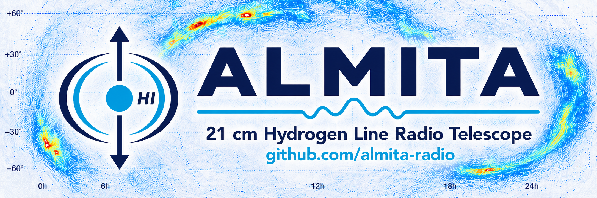
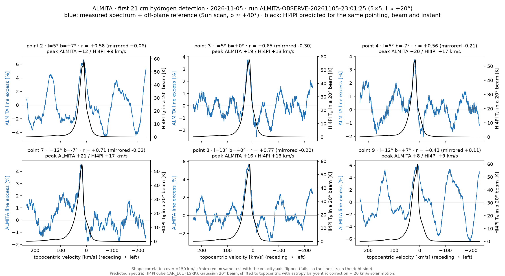
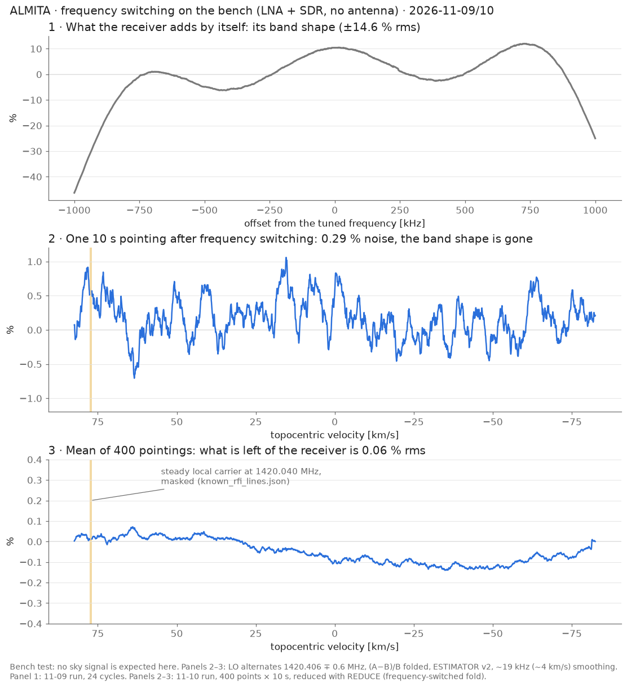
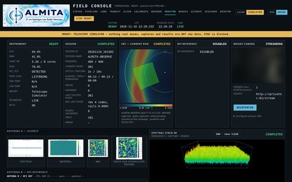
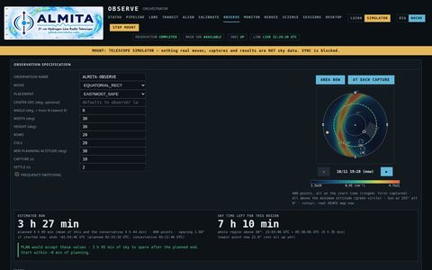
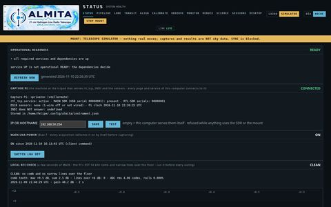
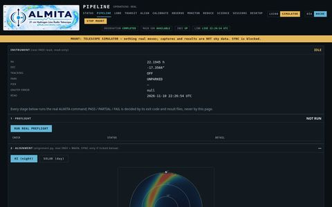
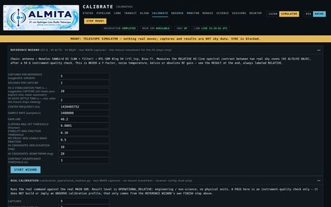
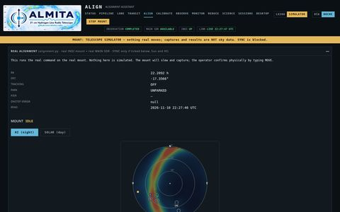

<p align="center">
  
</p>

# ALMITA

**Antenna Listening Mostly to Interference, Tentatively Astronomy**

ALMITA is a **fully open-source, open-hardware amateur radio astronomy project**: a **21 cm neutral hydrogen (HI) radio telescope** built in **Chile**
by **Felipe Fridman G.** It observes the **1420 MHz hydrogen line** with RTL-SDR receivers, a modified grid dish and an
OnStep equatorial mount. A notebook runs the web console and the processing, and a Raspberry Pi in a shielded box sits at the instrument.
Contact: **ffridman@gmail.com**

It combines INDI/OnStep mount control, automated sky planning, HDF5 acquisition, live RFI masking and a local web console
behind a login. It is **offline-first**: internet access is not required to observe.

Project site: <https://almita-radio.github.io/almita/>

ALMITA is mostly vibe-coded, extensively field-tested, occasionally threatened with a hammer, and still held together in
suspiciously many places by **plastic cable ties**. This is considered temporary. It has also been considered temporary for
quite some time.

> **Where the newest code is.** `main` holds the documentation, the licenses and the REDUCE/SCIENCE V1 core as it was frozen in October 2026. The web
> console and everything listed under [What is new](#what-is-new-up-to-november-2026) are developed on the branch
> [`rfi-masks-v1`](https://github.com/almita-radio/almita/tree/rfi-masks-v1), which builds on `web-polish-v1`. The merge into `main`
> is pending ([PR #7](https://github.com/almita-radio/almita/pull/7) is the first step).

## What it measures (and what it does not)

ALMITA records raw I/Q from an RTL-SDR while an equatorial mount steps through a planned sky mosaic, and turns it into
spectra, velocity cubes and maps.

**All HI products are relative / instrumental.** There is no absolute calibration in Kelvin (or any physical unit) yet; that is a
development goal, not a capability we pretend to have. The antenna beam used for mapping is an **operator-supplied, provisional
operational model** until a proper beam-characterisation campaign exists. Nothing in the pipeline interprets or classifies
astrophysical signals automatically.

## Pipeline

```text
OBSERVE  ->  REDUCE v1.1  ->  SCIENCE
raw I/Q      reduced spectra          beam-aware spatial gridding,
+ metadata   (masks, relative         LSRK velocity cube, relative integrated
(HDF5)       intensity, LSRK          maps, uncertainty / coverage maps
             velocity, uncertainty)
```

**About the versions.** REDUCE and SCIENCE V1 were **frozen in October 2026** as a fixed, verifiable reference
([REDUCE_V1_FREEZE](docs/REDUCE_V1_FREEZE.md), [SCIENCE_V1_FREEZE](docs/SCIENCE_V1_FREEZE.md)). Since then they were
reopened on purpose, twice:
- **REDUCE v1.1** folds frequency-switched captures (9 November 2026).
- **SCIENCE** draws its maps in an exact spherical frame, so a map can cross the celestial pole (6 November 2026).

Each change was tested and the freeze reference was updated. Other improvements are **opt-in** and wrap the engine without
changing it. **ESTIMATOR v2** is one of them: a better spectrum estimator *inside* REDUCE, not a REDUCE "version 2".

Supporting systems: **ALIGN** (conservative pointing alignment), **CALIBRATE** (receiver / gain characterisation) and
**RFI_REF** (an independent second SDR chain that watches the local RF environment without ever interfering with the main capture).

| Command (run from the repo root) | Purpose |
|---|---|
| `almita_observe.py` | plan and run observations |
| `almita_align.py` / `almita_calibrate.py` | alignment and calibration workflows |
| `almita_reduce.py` | RAW -> reduced spectra |
| `almita_science.py` | reduced spectra -> science products (`inspect`, `plan`, `run`, `replay`, `compare`, `validate`) |
| `almita_orchestrator_server.py` | the web console and its API on one port (:8088, login) |
| `transit_logger.py`, `lobe_transit.py` | solar transit: still-antenna logger / beam fit with the mount |
| `rfi_mask.py`, `rfi_mask_live.py`, `local_rfi_check.py` | RFI masks of every capture, live; quick local RFI check |

Every command has `--help`. The long-running services are described under `systemd/`.

## Results so far

### First 21 cm hydrogen detection (5 November 2026)

On its first night on a rooftop, in a 5 × 5 mosaic around galactic longitude l ≈ +20°, ALMITA saw the hydrogen line where
the HI4PI all-sky survey says it should be. For the six pointings inside the reference cube, the measured line has the shape
HI4PI predicts for the **same pointing, the same 20° beam and the same instant** (shape correlation +0.43 to +0.77). The
same test with the velocity axis flipped fails, so the line sits on the correct side. The peak velocity follows the predicted
one from point to point.

<p align="center">
  
</p>

What this is **not** yet:
- **Not a calibrated measurement.** The spectra are relative: each one is divided by an off-plane reference taken minutes
  earlier, and the receiver's ripple of ±2–6 % that remains is larger than everything except the line itself.
- **Not yet repeated.**
- **Peaks sit 3–6 km/s above HI4PI's.** This is not explained yet.
- **An earlier strip the same night (l = +10…+30°) showed nothing.** That is still an open question.

That leftover ripple is why the next step was frequency switching.

### Frequency switching (November 2026)

The receiver's own band shape is ±15 %, and it drifts. Dividing by another pointing minutes later leaves waves of a few
percent: the hydrogen line is only ~4–14 % on top of the system's own noise. With **frequency switching**, the SDR alternates
its tuning between 1420.406 MHz ∓ 0.6 MHz every 2 s (pausing 0.15 s per change, 95 % of the time recording). The
hydrogen line moves with the tuning; the receiver's shape does not. (A − B) / B cancels the shape, and the two copies of
the line are folded back together.

<p align="center">
  
</p>

This is a **bench test** with the LNA and the SDR but no antenna, so no sky signal is expected. On 400 pointings of 10 s each:
- the noise of one pointing is **0.29 %** (about 4 km/s resolution), close to the theoretical limit;
- what is left of the receiver in the mean of all 400 is **0.06 % rms**.

A steady local carrier at 1420.040 MHz sat inside the band in every pointing. It is now on a fixed list of known lines and is
masked. Its origin, somewhere in the local electronics, is still being hunted. The first open-sky test with switching across
the Milky Way is next.

## What is new (up to November 2026)

**Two machines instead of one.** The instrument used to run entirely on a Raspberry Pi 5, and that Pi 5 turned out to be the
loudest local interferer: it radiated a 357 kHz comb and a forest of narrow lines into the band. It was retired, and in
November 2026 the instrument was split:
- **Capture Pi:** a Raspberry Pi 4 inside a metal box at the dish. It runs `rtl_tcp`, INDI (started from KStars/Ekos on its desktop) and a small
  read-only **instrument agent** (`instrument_agent.py`, port 8099). The agent reports the SDR service, kernel messages, the SoC temperature and the
  USB devices, and nothing else. The CPU clock is fixed at boot.
- **Notebook:** runs the web console, captures, quick-look and processing as systemd *user* units (`systemd/notebook/`, `scripts/install_notebook.sh`).
  `instrument_forwarder` makes the capture Pi's SDR and INDI ports look local. The single-machine setup still works.

**Web console** (one port, `:8088`, with a login; DÍA/NOCHE theme for sunlight; LX200 / SIMULATOR mount switch and a **STOP MOUNT** button on every page):

| Page | What it does |
|---|---|
| STATUS | instrument health, temperatures, LNA (Bias-T) power, a quick **local RFI check** of MAIN |
| PIPELINE | the whole chain end to end: preflight → align → calibrate → observe → reduce → science |
| LOBE | beam measurement from a solar transit (drift or RA scan) with a live Gaussian fit |
| **TRANSIT** | the newest page: a band-power logger every 10 s with the antenna still, START / STOP / CLEAR, last 30 / 60 / 180 min with the capture Pi's temperature |
| ALIGN | conservative pointing alignment, guarded SYNC on the Sun or on HI, a SUN SYNC button for a hand-pointed dish |
| CALIBRATE | the calibration wizard (receiver/gain profile with a 50 Ω load) and HI reference zones |
| OBSERVE | plan and run a sky mosaic: PREFLIGHT, sky map of the grid, coverage drawn with the real 20° beam, auto meridian flip |
| MONITOR | live spectra, 3D spectral stack, **RFI MASK** panel and the *Unknown Pleasures* art view of the session |
| REDUCE | REDUCE per capture or per campaign, with optional **RFI mask** and **ESTIMATOR v2**, on several CPU cores |
| SCIENCE | cubes and maps, with HI4PI's expected map underneath for comparison |
| SESSIONS | catalog of every session with a sky map of the real pointings, filters and safe deletion |
| DESKTOP | the capture Pi's desktop (noVNC) behind the same login, so KStars can be seen remotely |

**Screenshots of every page,** full page, as each one looks when you land on it: [docs/WEB_CONSOLE_SCREENSHOTS.md](docs/WEB_CONSOLE_SCREENSHOTS.md).

<p align="center">
  <a href="docs/site/screenshots/monitor.jpg"></a>
  <a href="docs/site/screenshots/observe.jpg"></a>
  <a href="docs/site/screenshots/status.jpg"></a>
  <a href="docs/site/screenshots/pipeline.jpg"></a>
  <a href="docs/site/screenshots/calibrate.jpg"></a>
  <a href="docs/site/screenshots/align.jpg"></a>
</p>

**RFI work.**
- The local interference was hunted down. The 357 kHz comb and the forest of narrow lines were radiated by the **Raspberry Pi 5** itself and by the
  thermometer harness on its GPIO.
- The new capture computer, a **Raspberry Pi 4** in a closed metal box at least 1 m from the feed, does not show the comb. A person standing
  close to the electronics or the feed still brings some lines back.
- `rfi_mask.py` / `rfi_mask_live.py` now flag comb teeth, narrow lines and time pulses in every capture as it is recorded.
- REDUCE can drop those frames and flag those channels (opt-in; the REDUCE engine itself is unchanged).

**Feed and receiver.**
- MAIN is now an RTL-SDR Blog V3 (the V4 was retired) with a Nooelec SAWbird+ H1 LNA.
- A Y-factor of only ~1 dB on 2026-10-18 led to a new DIY feed: a copper-strip dipole in a 3D-printed case, modelled with NEC2.
- The 12 cm reflector plate is now fitted. A Pawsey balun, which keeps current off the outside of the coax, comes next, and with it a second version of the feed.

**Frequency switching, end to end (development branch).** OBSERVE has a FREQUENCY SWITCHING checkbox; REDUCE folds the
switched captures; QUICKLOOK and STATUS (HYDROGEN LINE panel) show them live. See [Results so far](#results-so-far).

**REDUCE got faster and cleaner (opt-in; these wrap the engine without changing it):**
- **ESTIMATOR v2:** windows that overlap by half, averaged instead of taking the median, plus *spectral kurtosis* to leave out pulses and bursts only
  where and when they happen. It uses about 95 % of the recorded time instead of about a third. With frequency switching that is the same as 3–4.6× more observing time.
- **Several CPU cores:** 400 points reduce in about 4 minutes.
- **Known RFI lines:** a short, editable list of steady local carriers is masked, frequency-switched captures included.

**CALIBRATE measures the receiver's Y-factor** (50 Ω load against cold sky) and, with the load temperature, the system temperature.
On 2026-11-05 it gave Y = 1.53 dB. Turning the relative spectra into Kelvin is the next step.

**SCIENCE draws what HI4PI expects** for the same area and beam directly under ALMITA's own maps, so shapes can be compared at a glance.
Maps across the celestial pole now use an exact spherical frame.

**Still pending.** Results stay relative and instrumental, the beam is still provisional, and the hydrogen detection above
has to be repeated. Next: an open-sky night with frequency switching across the Milky Way, solar alignment, a Y-factor with
the current feed, and the Pawsey balun.

## Hardware (short)

Notebook (web + processing) and a Raspberry Pi 4 capture box (`rtl_tcp`, INDI) - RTL-SDR Blog V3 (MAIN) - Nooelec SAWbird+ H1 LNA -
DIY 1420 MHz dipole feed with a reflector plate on a modified ~90 × 60 cm grid dish - equatorial mount with OnStep + INDI. A second, independent
RFI_REF chain (RTL-SDR + FM notch + wideband LNA) is supported by the software but currently disconnected. The DS18B20 thermometers are off
while their harness is an RF source. Intentionally accessible, experimental and repairable; not a commercial kit.
ALMITA-original hardware design and integration documentation are published under **CERN-OHL-S-2.0**; software is **MIT licensed**.
Commercial modules remain under their manufacturers' terms. Details: [docs/hardware/](docs/hardware/) and [docs/ALMITA_OVERVIEW.md](docs/ALMITA_OVERVIEW.md).

## Documentation

| Topic | Where |
|---|---|
| Project overview (hardware, workflow, grid generator, alignment, gain, RFI reference) | [docs/ALMITA_OVERVIEW.md](docs/ALMITA_OVERVIEW.md) |
| Observation planning / grids | [docs/observe/](docs/observe/) |
| ALIGN | [docs/HI_ALIGNMENT_MODEL.md](docs/HI_ALIGNMENT_MODEL.md), [docs/HI_FIRST_LIGHT_RUNBOOK.md](docs/HI_FIRST_LIGHT_RUNBOOK.md) |
| CALIBRATE | [docs/CALIBRATION_SCOPE.md](docs/CALIBRATION_SCOPE.md), [docs/CALIBRATION_MODEL.md](docs/CALIBRATION_MODEL.md), [docs/CALIBRATION_FIRST_TEST_RUNBOOK.md](docs/CALIBRATION_FIRST_TEST_RUNBOOK.md) |
| REDUCE | [docs/REDUCE_SCOPE.md](docs/REDUCE_SCOPE.md), [docs/REDUCE_MODEL.md](docs/REDUCE_MODEL.md), [docs/REDUCE_PIPELINE.md](docs/REDUCE_PIPELINE.md), [docs/REDUCE_V1_FREEZE.md](docs/REDUCE_V1_FREEZE.md), [runbook](docs/REDUCE_FIRST_RUNBOOK.md) |
| SCIENCE | [docs/SCIENCE_SCOPE.md](docs/SCIENCE_SCOPE.md), [docs/SCIENCE_MODEL.md](docs/SCIENCE_MODEL.md), [docs/SCIENCE_PIPELINE.md](docs/SCIENCE_PIPELINE.md), [docs/SCIENCE_ACCEPTANCE.md](docs/SCIENCE_ACCEPTANCE.md), [docs/SCIENCE_V1_FREEZE.md](docs/SCIENCE_V1_FREEZE.md), [runbook](docs/SCIENCE_FIRST_RUNBOOK.md) |
| Web console | [screenshots of every page](docs/WEB_CONSOLE_SCREENSHOTS.md), [docs/WEB_ALIGNMENT_CALIBRATION.md](docs/WEB_ALIGNMENT_CALIBRATION.md); the current twelve-page console: [WEB_ARCHITECTURE](https://github.com/almita-radio/almita/blob/rfi-masks-v1/docs/WEB_ARCHITECTURE.md), [WEB_OPERATIONS](https://github.com/almita-radio/almita/blob/rfi-masks-v1/docs/WEB_OPERATIONS.md) (development branch) |
| Hardware (architecture, build, BOM, RF and wiring, DIY feed, mount model, rtl_tcp service) | [docs/hardware/](docs/hardware/) |
| Full documentation index | [docs/README.md](docs/README.md) |

## Status and installation

Experimental and field-tested, first on one Raspberry Pi 5 and since November 2026 on a notebook plus a Raspberry Pi 4 capture box.
ALMITA is **not packaged**: it runs from a checkout under a Python virtual environment (`requirements.txt`). The services are in `systemd/`;
on the development branch `scripts/install_notebook.sh` and `scripts/install_capture_pi.sh` install them. There is no `pip install`.

Tests: from the repo root, `python -m pytest` (test files are in [tests/](tests/)). Some tests need optional packages (for example `indi`) or real
historical campaigns under `data/`, and fail or skip without them.
