# Web console — one screen per page

Screenshots of ALMITA's web console, taken on 2026-11-03 (night, Chile) from the running notebook + Raspberry Pi 4 capture
box. The data on them is real: the instrument was indoors that night with the mount controller on the bench, so the sky
views and spectra show the instrument's state, not an astronomical result. The console runs on one port behind a login;
every page shares the same header: navigation, the DÍA/NOCHE theme for sunlight, the LX200 / SIMULATOR mount switch and
**STOP MOUNT**. The code is on the development branch [`rfi-masks-v1`](https://github.com/almita-radio/almita/tree/rfi-masks-v1).

## STATUS — instrument health
Operational readiness, the capture Pi (its `rtl_tcp`, SDR serial, sensors), the LNA (Bias-T) power, a quick **local RFI
check** of MAIN (here: faint, comb teeth ≤ +2.8 dB) and the temperatures.

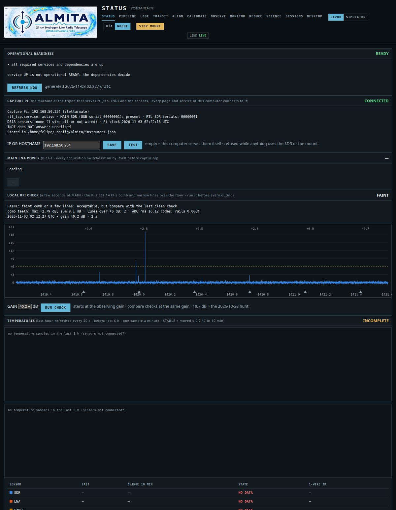

## PIPELINE — the whole chain end to end
Preflight → alignment → calibration → grid observation → reduce → science, each stage running the real command and judged
by its exit code and result files. The alignment stage shows the all-sky HI4PI map (the Milky Way's hydrogen, in colour)
with the candidate HI areas A, B and C.

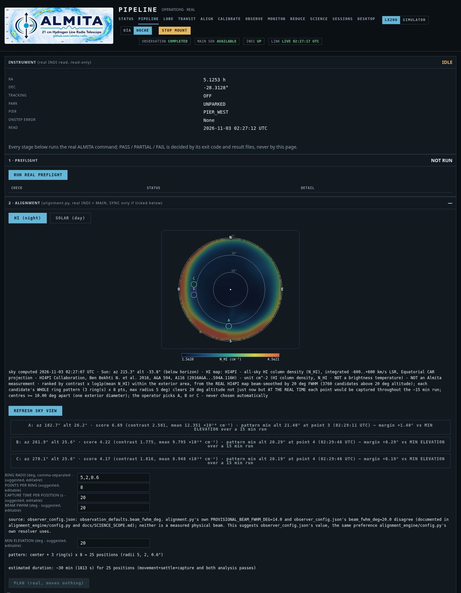

## LOBE — beam from a solar transit (with the mount)
Drift (mount still, tracking off) or scan (steps in RA) across the Sun, with a live Gaussian fit of the beam. The sky
view shows the mount's pointing with the expected beam; the Sun was below the horizon, so START is blocked.

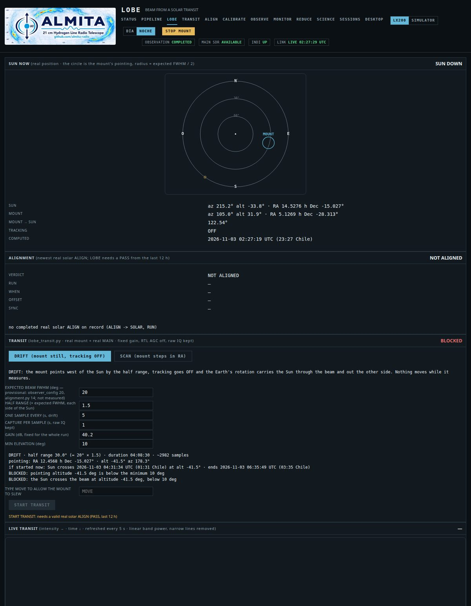

## TRANSIT — the Sun through a still antenna
The newest page: band power every 10 s with START / STOP / CLEAR, the last 30 / 60 / 180 minutes, the capture Pi's
temperature on the right axis (both axes 0–100 by default, AUTO on request). Every run is kept whole on disk (spectra,
per-frame power, tuning) so the curve can be rebuilt.

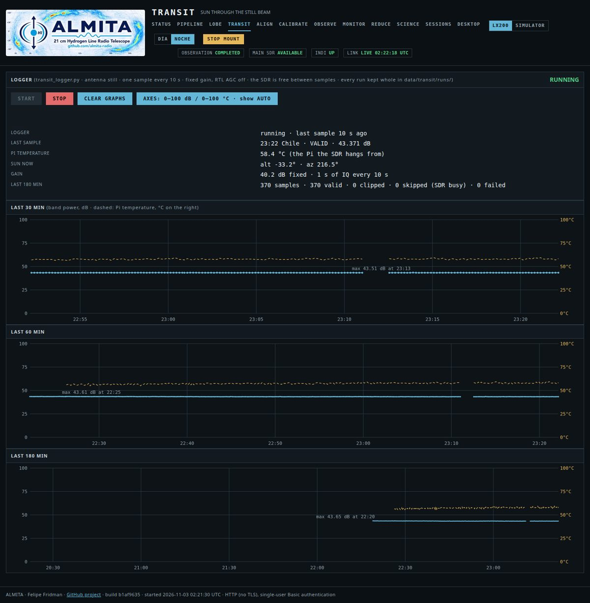

## ALIGN — conservative pointing alignment
HI (night) or solar (day) alignment on the real mount, with an all-sky HI4PI map to pick bright HI areas, guarded SYNC and
a SUN SYNC button for a hand-pointed dish.

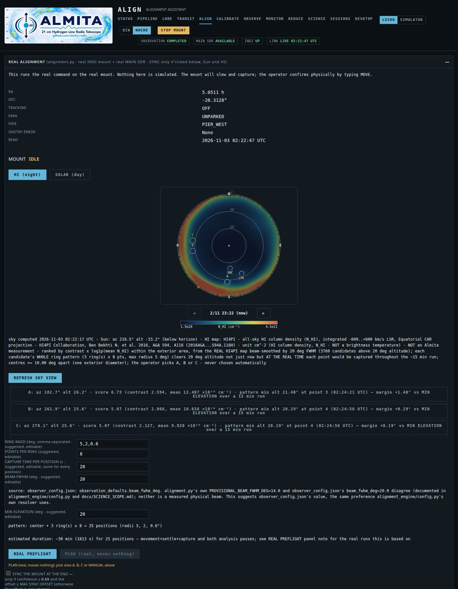

## CALIBRATE — receiver / gain profile
The reference wizard (a 50 Ω load and two HI zones), the operational calibration and replays. Results are always labelled
RELATIVE; no Kelvin is claimed.

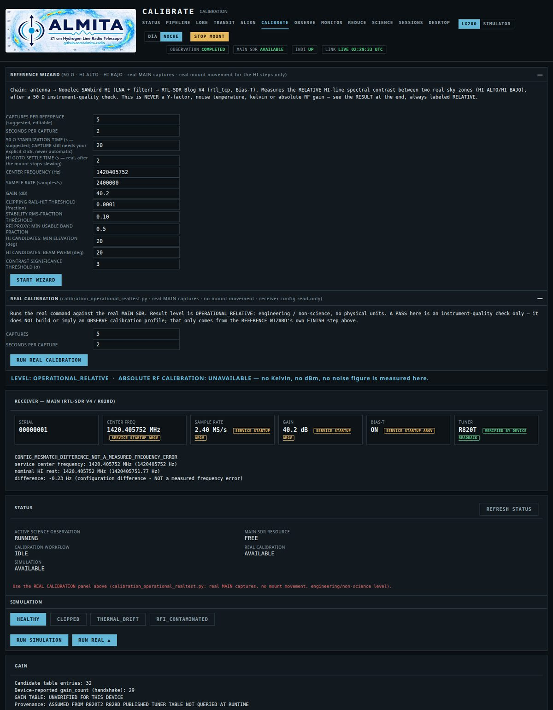

## OBSERVE — plan and run a sky mosaic
Grid specification, the sky projection of the planned region over the real HI4PI map (the Milky Way's hydrogen in colour,
the minimum-altitude circle, the Magellanic Clouds marked), the run and sky-time estimates, the calibration profile check,
and the run's progress (here a finished 9-point run).

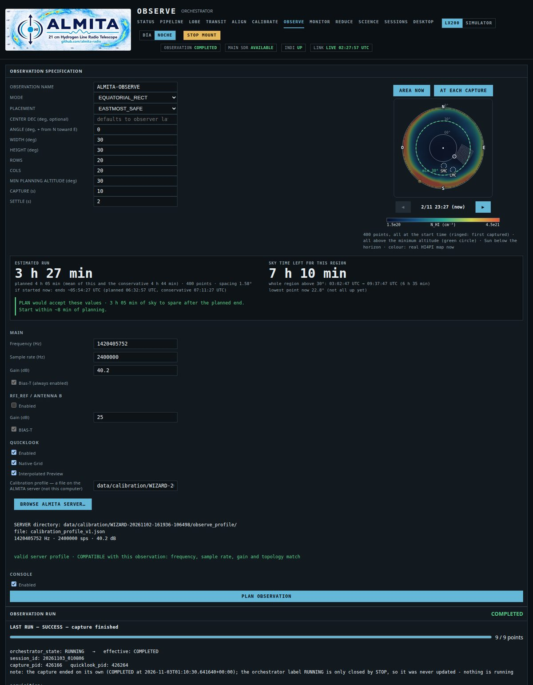

## MONITOR — live view of a run
Instrument and session state, the **RFI MASK** panel (clean spectrum and what the mask removes: comb teeth in red, narrow
lines in yellow), the 3D spectral stack and the *Unknown Pleasures* art view of the session. The mount camera tile is
blurred in this screenshot.

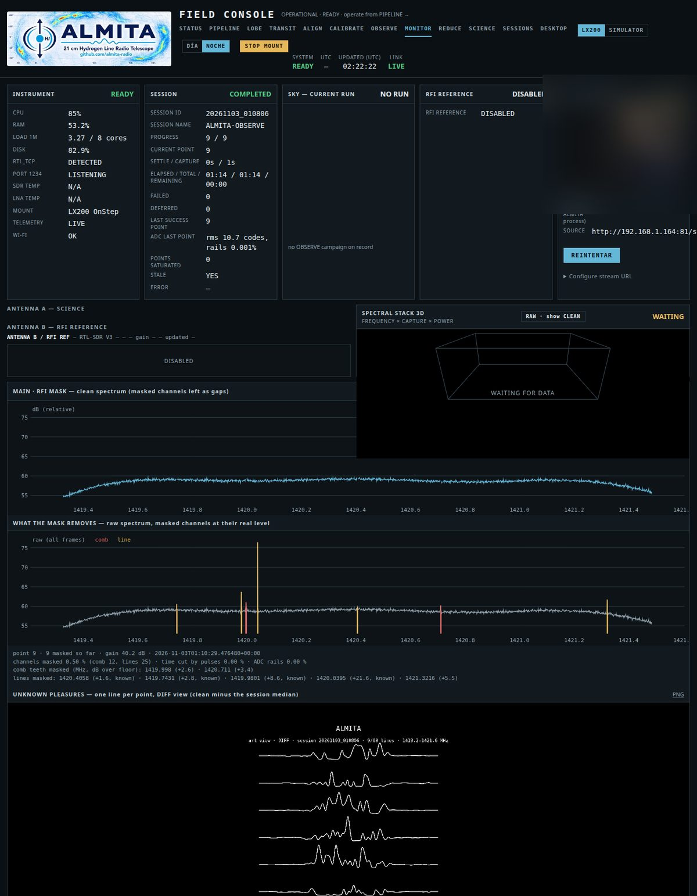

## REDUCE — REDUCE V1 (frozen engine)
Raw HDF5 → Level 1 spectra, per capture or per campaign, with an optional RFI mask.

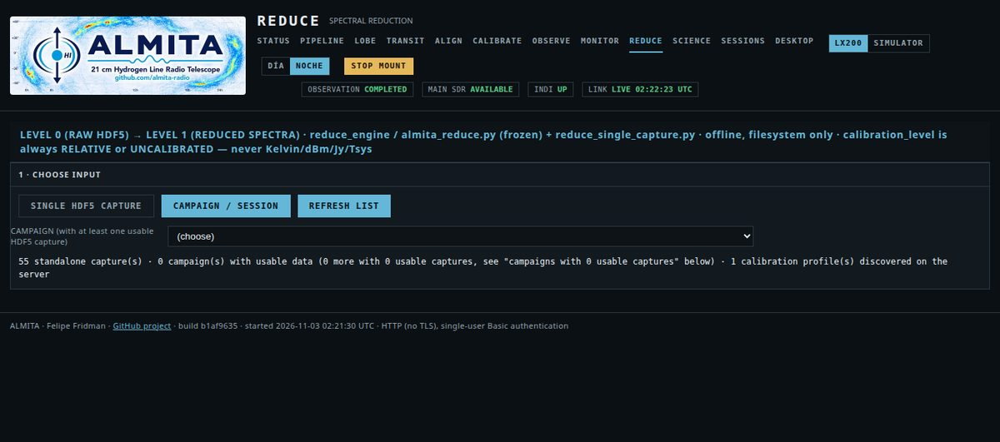

## SCIENCE — SCIENCE V1 (frozen engine)
Level 1 → Level 2 cubes and heatmaps, relative and dimensionless.

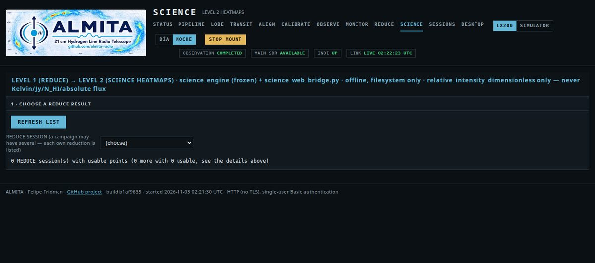

## SESSIONS — the catalog
Every stored session with filters, a sky map of its real pointings and safe deletion (preview first). Empty in this shot: every session had just been deleted from this very page.

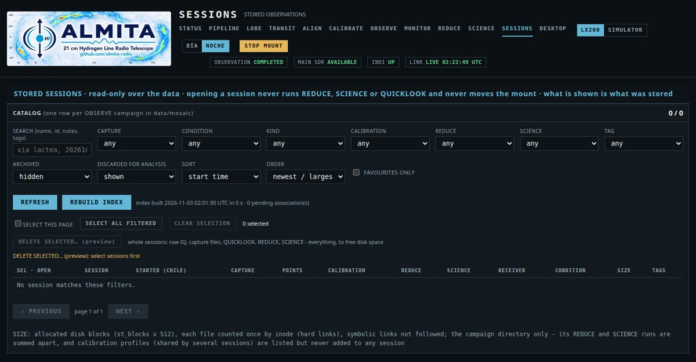

## DESKTOP — the capture Pi's desktop
The capture Pi's own desktop (noVNC behind the same login): KStars/Ekos with the LX200 OnStep INDI panel, so the mount
can be watched remotely. This one was captured on the Pi itself.

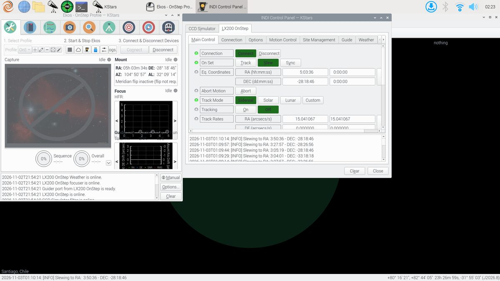
