# Web console — one screen per page

Full-page screenshots of ALMITA's web console as each page looks **when you land on it**, taken on 2026-11-10 from the
notebook with the Raspberry Pi 4 capture box. The data on them is real but not astronomical. The last session is a
400-point frequency-switching **bench test** (LNA and SDR, no antenna), and the mount switch was on **SIMULATOR** (the
yellow banner), so the sky views show the instrument's state, not a sky result.

The console runs on one port behind a login. Every page shares the same header: navigation, the DÍA/NOCHE theme for
sunlight, the LX200 / SIMULATOR mount switch and **STOP MOUNT**. The code is on the development branch
[`rfi-masks-v1`](https://github.com/almita-radio/almita/tree/rfi-masks-v1). In these screenshots, network addresses are
replaced by `<private>` and the mount camera is blurred.

## MONITOR — live view of a run
Instrument and session state, the sky map of the run over the HI4PI hydrogen map, the mount camera, the quick-look products
and the **3D spectral stack** (frequency × capture × power). Below them are the **RFI MASK** panel (the clean spectrum, and
what the mask removes: comb teeth in red, narrow lines in yellow), the *Unknown Pleasures* art view of the session (one line
per point), and the activity log, which always shows its newest line.

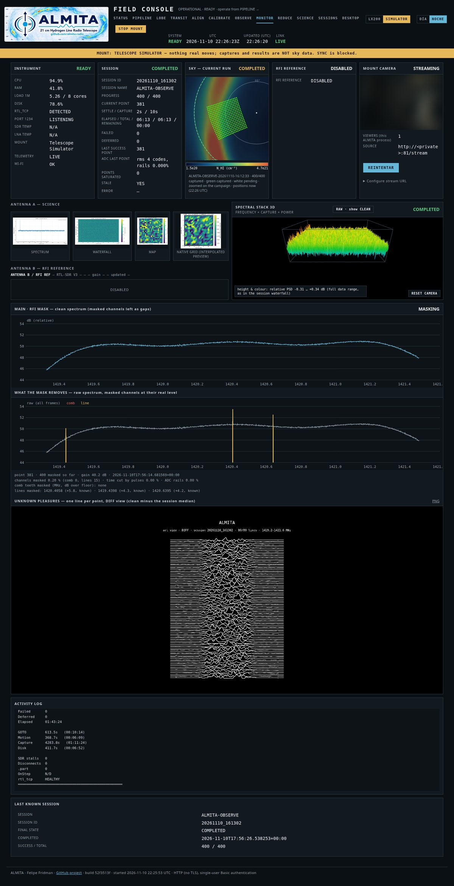

## STATUS — instrument health
Operational readiness, the capture Pi (its `rtl_tcp`, SDR and sensors), the LNA (Bias-T) power, a quick **local RFI
check** of MAIN, the **HYDROGEN LINE** panel (a short frequency-switching run on demand) and the temperatures.

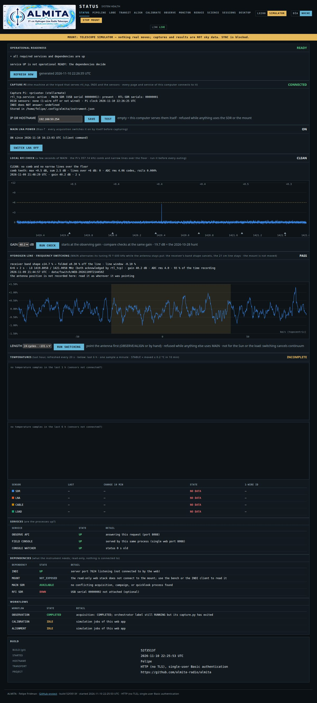

## PIPELINE — the whole chain end to end
Preflight → alignment → calibration → grid observation → reduce → science. Each stage runs the real command and is judged
by its exit code and result files. The alignment stage shows the all-sky HI4PI map with the candidate HI areas A, B and C.
The REDUCE stage shows its last jobs, here the reduction of the 400-point bench run.

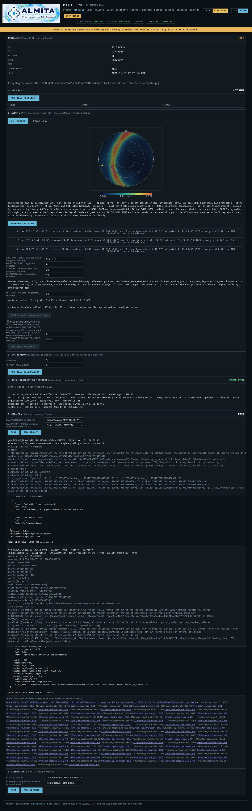

## LOBE — beam from a solar transit (with the mount)
Drift (mount still, tracking off) or scan (steps in RA) across the Sun, with a live Gaussian fit of the beam.

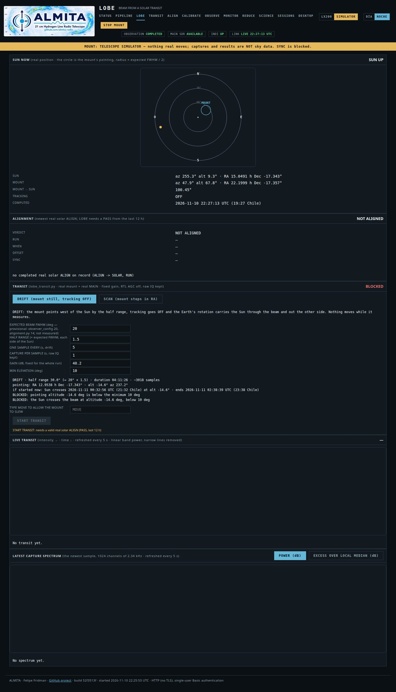

## TRANSIT — the Sun through a still antenna
Band power every 10 s with START / STOP / CLEAR, the last 30 / 60 / 180 minutes, and the capture Pi's temperature.

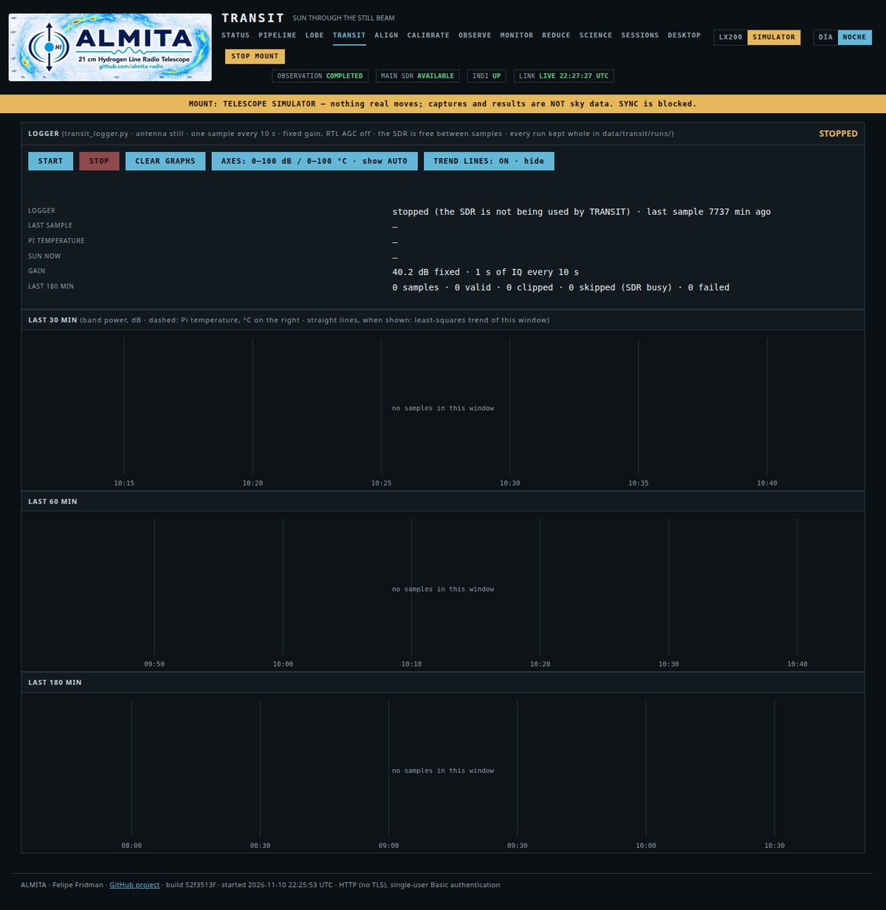

## ALIGN — conservative pointing alignment
HI (night) or solar (day) alignment on the real mount, with an all-sky HI4PI map to pick bright HI areas, a guarded SYNC
and a SUN SYNC button for a hand-pointed dish.

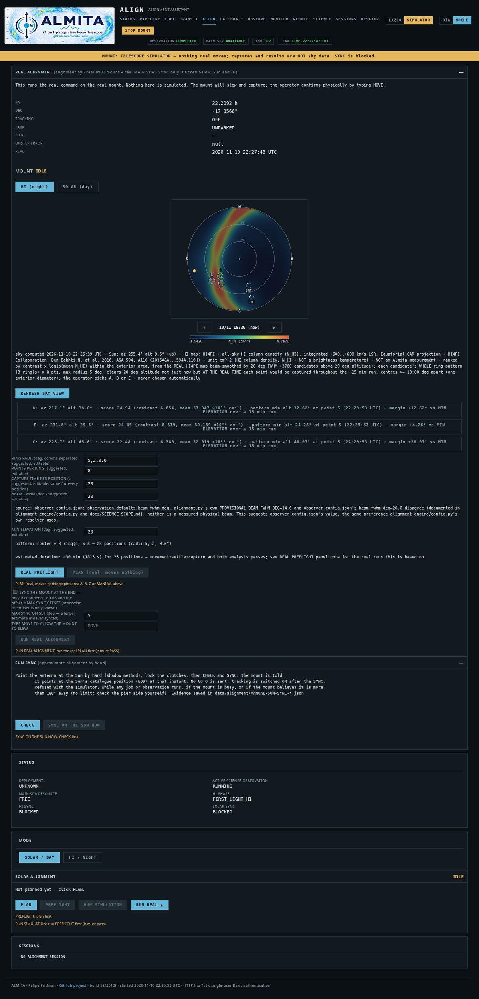

## CALIBRATE — receiver / gain profile and Y-factor
The reference wizard (a 50 Ω load and two HI zones). It computes the receiver's **Y-factor** (load against cold sky) and,
with the load's temperature, the system temperature. It also holds the operational calibration and replays. Spectra stay
RELATIVE; no Kelvin is claimed for them yet.

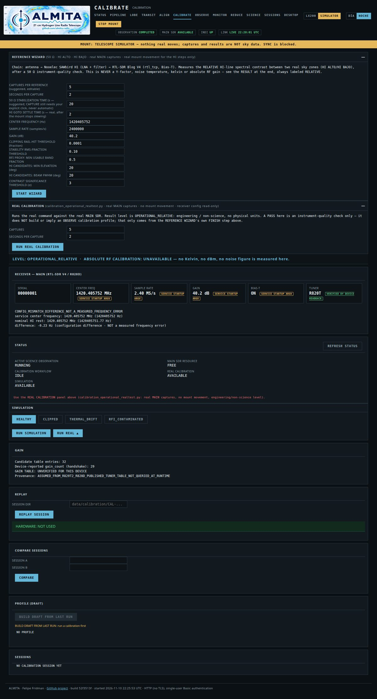

## OBSERVE — plan and run a sky mosaic
Grid specification with a **FREQUENCY SWITCHING** checkbox, and the sky projection of the planned region over the HI4PI map
(the minimum-altitude circle and the Magellanic Clouds marked). Then the run and sky-time estimates and the run's progress.

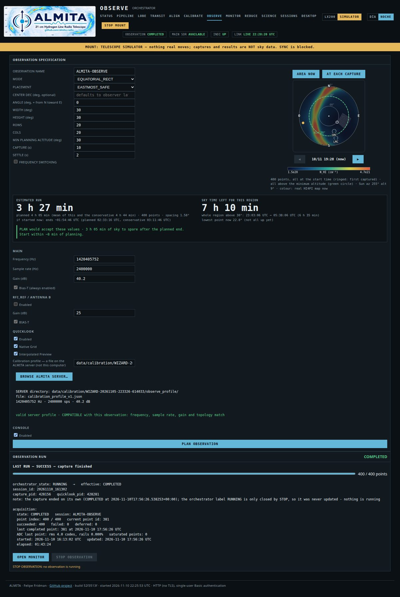

## REDUCE — raw captures to spectra
Raw HDF5 → Level 1 spectra, per capture or per campaign. Opt-in **RFI MASK** (including a list of known local carriers)
and **ESTIMATOR v2** (overlapping windows + spectral kurtosis). It runs on several CPU cores.

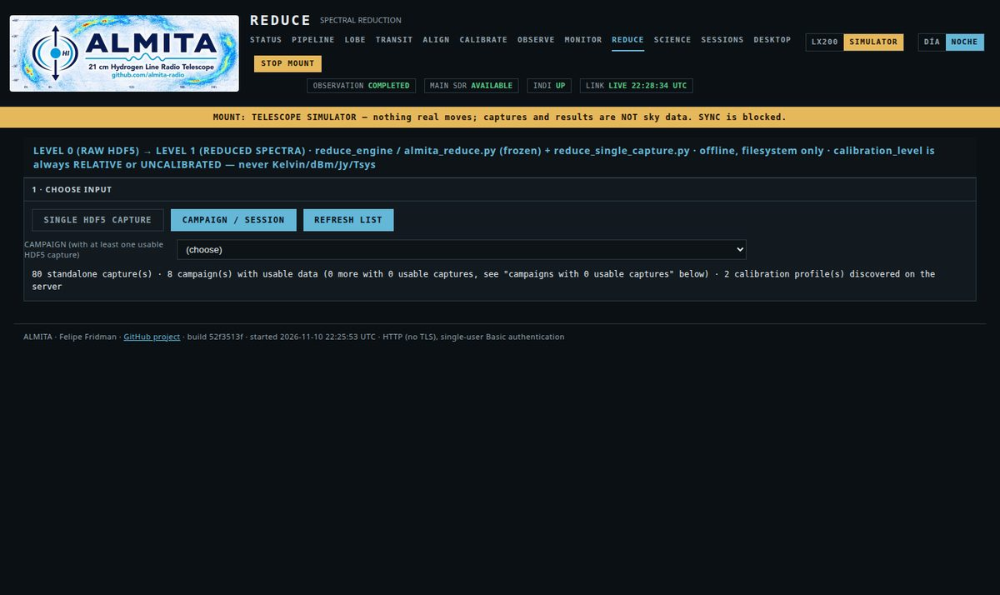

## SCIENCE — cubes and maps
Level 1 → Level 2 cubes and heatmaps, relative and dimensionless, with the map HI4PI predicts for the same area and beam
drawn underneath for comparison.

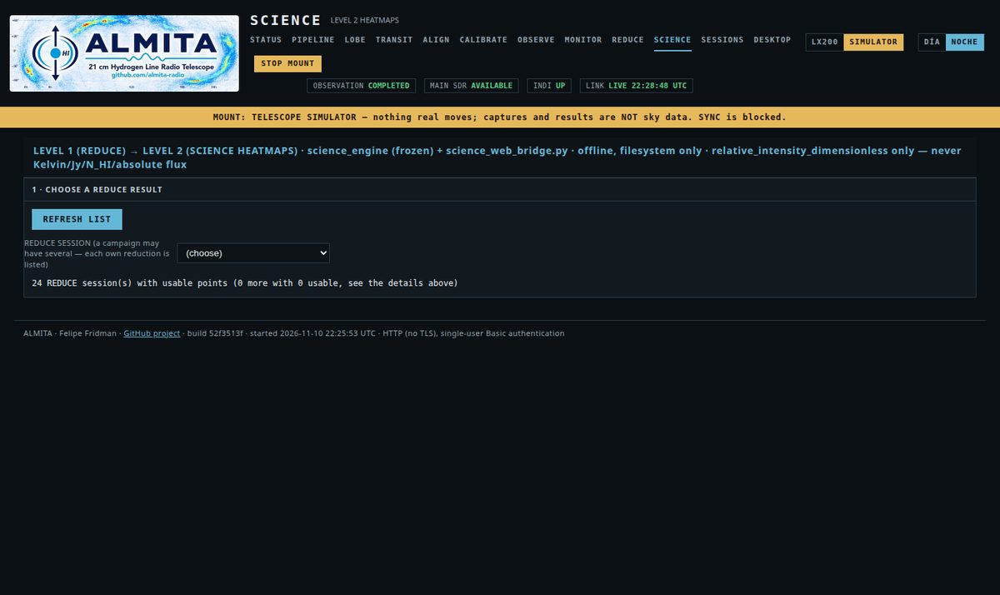

## SESSIONS — the catalog
Every stored session with filters, a sky map of its real pointings and safe deletion (preview first).

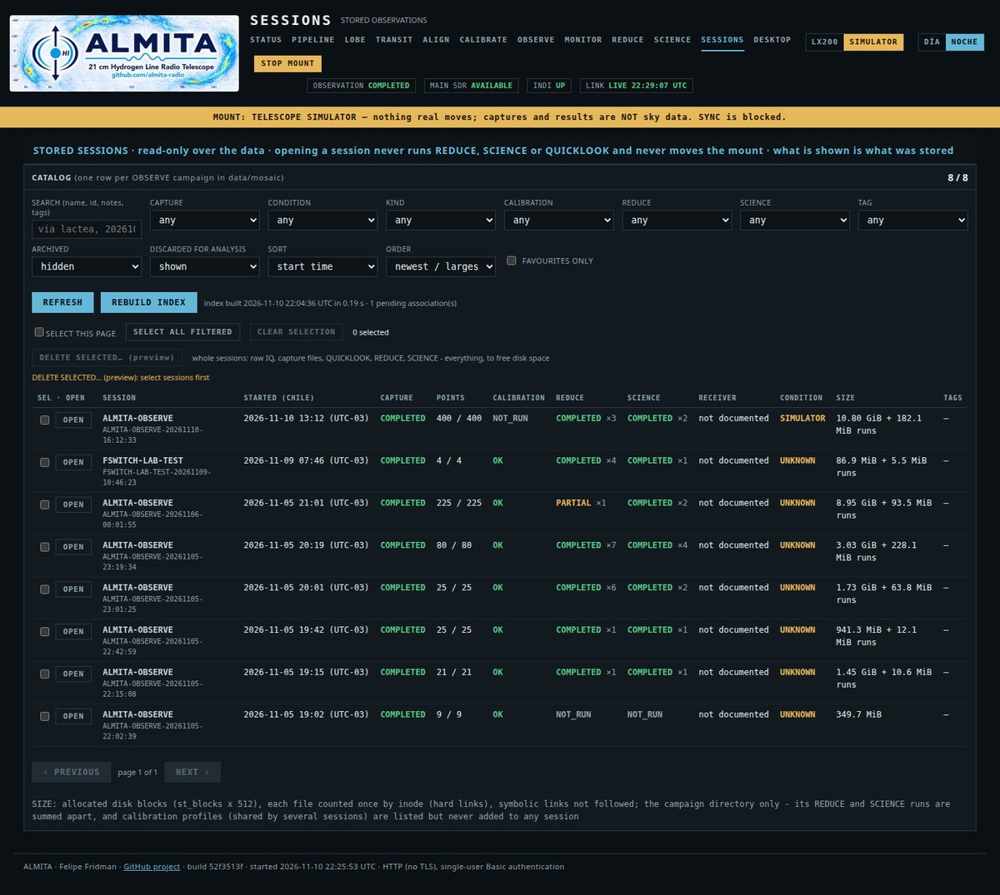

## DESKTOP — the capture Pi's desktop
The capture Pi's own desktop (noVNC behind the same login): KStars/Ekos with the LX200 OnStep INDI panel, so the mount
can be watched remotely. This one is from 2026-11-03, captured on the Pi itself.

